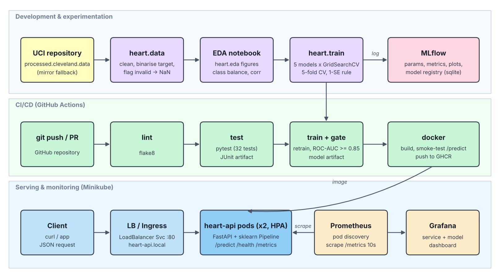

# Heart Disease Risk Prediction — End-to-End MLOps

Binary classifier for the presence of heart disease (UCI Cleveland dataset), packaged as a
monitored FastAPI service with MLflow tracking, GitHub Actions CI/CD, Docker and Kubernetes
(Minikube) deployment, and Prometheus + Grafana monitoring.



## Results at a glance

| Model | CV ROC-AUC (±SD) | Test ROC-AUC | Test accuracy | Test recall |
|---|---|---|---|---|
| Random Forest | 0.916 ± 0.029 | 0.893 | 0.787 | 0.679 |
| SVM (RBF, calibrated) | 0.913 ± 0.039 | 0.911 | 0.852 | 0.786 |
| **Logistic Regression (champion)** | 0.908 ± 0.037 | **0.922** | **0.852** | **0.786** |
| XGBoost | 0.903 ± 0.037 | 0.895 | 0.787 | 0.679 |
| KNN | 0.894 ± 0.040 | 0.905 | 0.787 | 0.714 |

The champion is chosen with the **one-standard-error rule** on CV ROC-AUC (the test split is never
used for selection): all five families fall within one SD of the best, so the simplest, most
interpretable model, L2-regularised Logistic Regression (C = 0.1), is selected.

## Repository layout

```
├── src/heart/            data.py · eda.py · features.py · train.py · evaluate.py · config.py
├── api/                  app.py (FastAPI, logging, Prometheus metrics) · schemas.py
├── notebooks/            01_eda · 02_training_and_tracking · 03_inference  (executed)
├── tests/                pytest suite: data, features, models, API (32 tests)
├── data/raw|processed/   raw Cleveland file + cleaned CSV
├── models/               model.joblib (full sklearn Pipeline) + model_meta.json
├── k8s/                  namespace, deployment, service (LoadBalancer), ingress, HPA,
│   └── monitoring/       Prometheus (pod discovery + RBAC) and Grafana
├── monitoring/           Prometheus/Grafana config + dashboard JSON for docker compose
├── .github/workflows/    ci.yml: lint → test → train + quality gate → docker build/smoke/push
├── scripts/              download, deploy_minikube, smoke_test, load_test, predict_cli
├── reports/figures/      EDA, per-model evaluation plots, architecture diagram
├── screenshots/          screenshots for the report
├── Dockerfile · docker-compose.yml · requirements.txt · requirements-serve.txt · environment.yml
└── report/               final written report (.docx)
```

## 1. Setup (clean environment)

Python 3.13 is used everywhere (local, CI, Docker).

```bash
git clone <your-repo-url> && cd heart-risk-mlops
python -m venv .venv && source .venv/bin/activate      # Windows: .venv\Scripts\activate
pip install -r requirements.txt && pip install -e .
# or: conda env create -f environment.yml && conda activate heart-mlops
```

## 2. Data

```bash
python -m heart.data          # or ./scripts/download_data.sh
```
Downloads `processed.cleveland.data` from the UCI repository (falls back to a GitHub mirror,
recoded to UCI coding) and writes `data/processed/heart_clean.csv` (302 rows after removing one
duplicate; `ca` 4 missing and `thal` 2 missing, imputed inside the model pipeline).

## 3. EDA, training and experiment tracking

```bash
python -m heart.eda                    # figures -> reports/figures/
python -m heart.train                  # ~1 min; 5 model families, 77 grid candidates
mlflow ui --backend-store-uri sqlite:///mlflow.db --port 5000   # http://localhost:5000
```
Each training run logs 83 MLflow runs: one parent run per model family (best params, CV mean
and SD, test metrics, confusion matrix, ROC curve, feature importance, CV table, the fitted
pipeline with signature), one nested run per grid candidate, and a `champion-selection` run.
The champion is registered as `heart-disease-classifier` in the MLflow model registry.

## 4. Tests and lint

```bash
flake8 src api tests
pytest -v
```

## 5. Serve locally

```bash
uvicorn api.app:app --port 8000          # docs at http://localhost:8000/docs
./scripts/smoke_test.sh                  # health, ready, model-info, predict, metrics
python scripts/predict_cli.py            # offline inference, no server
```

Request (single record or `{"instances": [...]}` for a batch; `ca` and `thal` optional):
```bash
curl -X POST localhost:8000/predict -H 'Content-Type: application/json' \
  -d '{"age":67,"sex":1,"cp":4,"trestbps":160,"chol":286,"fbs":0,"restecg":2,
       "thalach":108,"exang":1,"oldpeak":1.5,"slope":2,"ca":3,"thal":3}'
```
Response:
```json
{"model_name":"logistic_regression","model_version":"fc709b7b",
 "predictions":[{"prediction":1,"label":"disease","confidence":0.9652,"probability_disease":0.9652}]}
```

## 6. Docker

```bash
docker build -t heart-risk-api:1.0.0 .
docker run --rm -p 8000:8000 heart-risk-api:1.0.0
./scripts/smoke_test.sh http://localhost:8000
```
Multi-stage build, non-root user (uid 1001), healthcheck on `/health`.

Full local stack with monitoring:
```bash
docker compose up --build
python scripts/load_test.py --n 300 --rps 5       # generate traffic
# Grafana http://localhost:3000 (admin/admin) → MLOps → "Heart Disease API"
```

## 7. Kubernetes (Minikube)

```bash
./scripts/deploy_minikube.sh        # start minikube, build image inside it, kubectl apply -k k8s/
minikube tunnel                     # separate terminal: gives the LoadBalancer an external IP
kubectl -n heart-mlops get svc heart-api
./scripts/smoke_test.sh http://<EXTERNAL-IP>
```
Ingress: `minikube addons enable ingress`, add `$(minikube ip) heart-api.local` to `/etc/hosts`,
then `curl http://heart-api.local/health`.
Monitoring: `minikube service -n heart-mlops grafana` and `minikube service -n heart-mlops prometheus`.

## 8. CI/CD

`.github/workflows/ci.yml` runs on every push and PR:

1. **lint**: flake8 (fails the pipeline on style or syntax errors)
2. **test**: pytest; JUnit report uploaded as an artifact
3. **train**: full training with MLflow; quality gate fails if champion CV ROC-AUC < 0.85;
   uploads model, `mlflow.db`, plots and training log
4. **docker**: builds the image with the model from step 3, runs it, calls `/predict`,
   uploads container logs; on `main`, pushes to GHCR

## Monitoring

The API emits JSON logs for every request (request id, path, status, latency) and every
prediction (labels, probabilities). Prometheus metrics at `/metrics`:
`api_requests_total`, `api_request_latency_seconds`, `model_predictions_total{label}`,
`model_prediction_confidence`, `model_probability_disease`, `model_loaded`.
The Grafana dashboard shows request rate, p50/p95/p99 latency, error ratio, predictions by
label and mean confidence (useful as a simple drift signal).

## Dataset

Detrano, R. et al. UCI Machine Learning Repository: Heart Disease.
https://archive.ics.uci.edu/dataset/45/heart+disease
